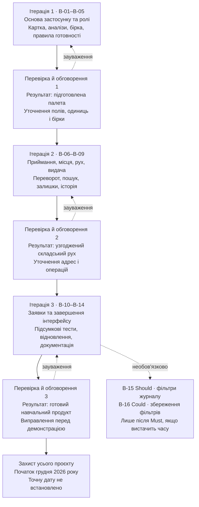

# Дорожня карта Свісс Кроно

[Редагована схема draw.io](roadmap.drawio) · [Зображення SVG](roadmap.svg)

Детальні цілі, результати, ризики та критерії завершення наведено в [Iterations.md](../Iterations.md), задачі — у [backlog](../requirements/backlog.md).

Кожна ітерація включає уточнення вимог, аналіз ризиків, розробку та перевірки. Суцільні стрілки показують основний рух, пунктирні — повернення до виправлень і необов’язкові задачі. Це послідовність робіт, а не календар із затвердженими датами. Усі задачі реалізації поки заплановані.

Пошук і залишки входять до другої ітерації. Тестування починається з першої ітерації, а підсумкові перевірки B-12–B-14 завершуються в третій.

## Редагування схеми

[Завантажити roadmap.drawio](roadmap.drawio) і відкрити через «Файл → Відкрити з → Пристрій» у [diagrams.net](https://app.diagrams.net/). Блоки, підписи й стрілки редагуються окремо. Mermaid у цьому документі відображає той самий план і доступний без завантаження файлу на GitHub.
